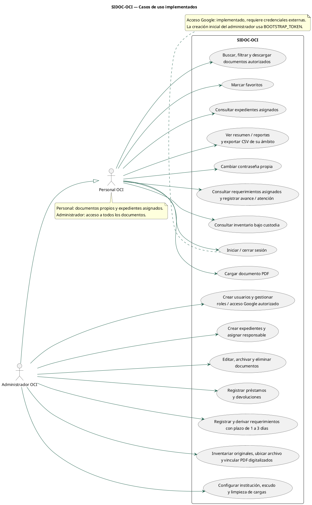
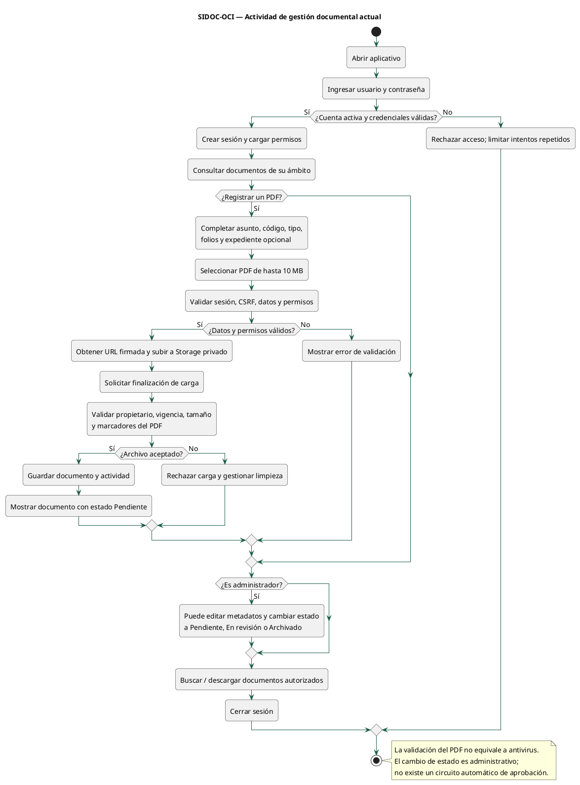
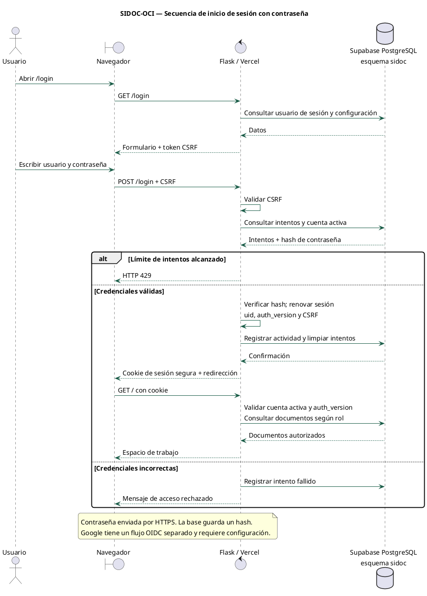
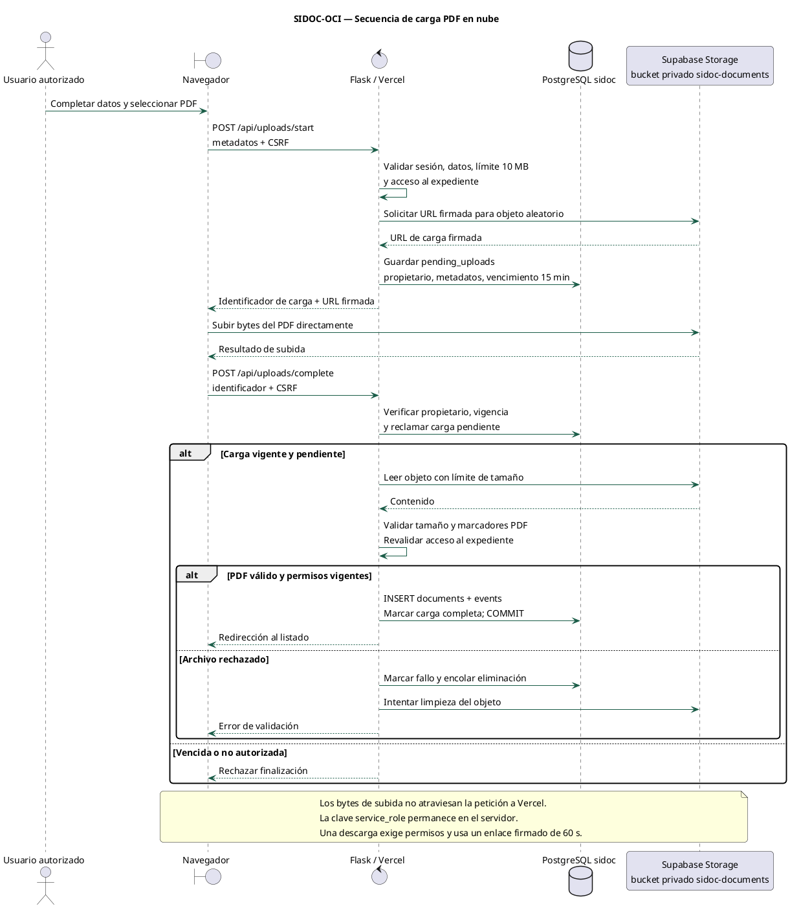
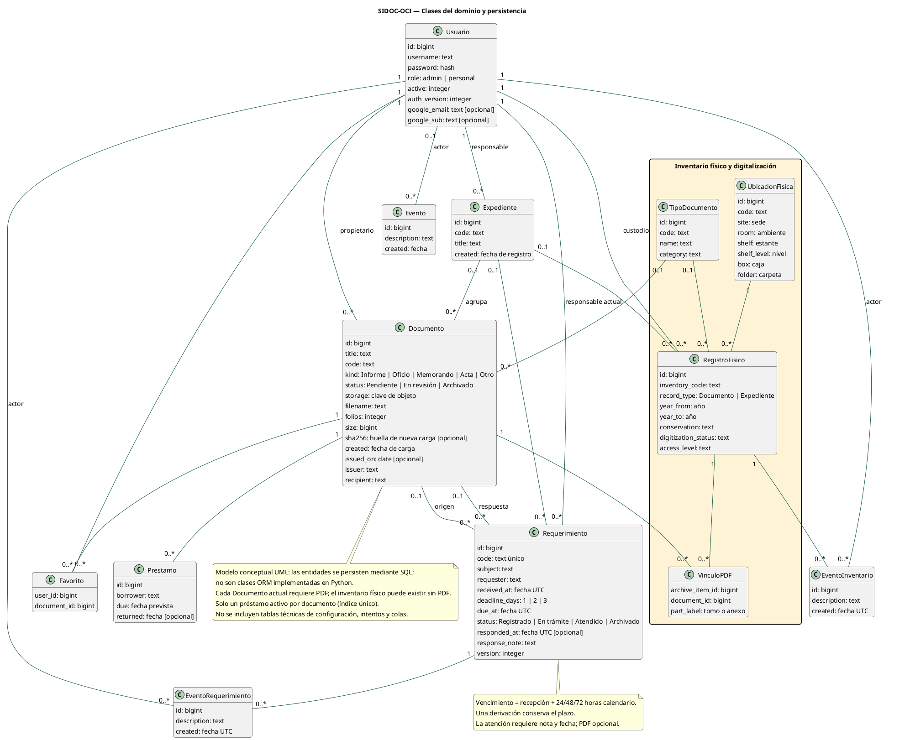
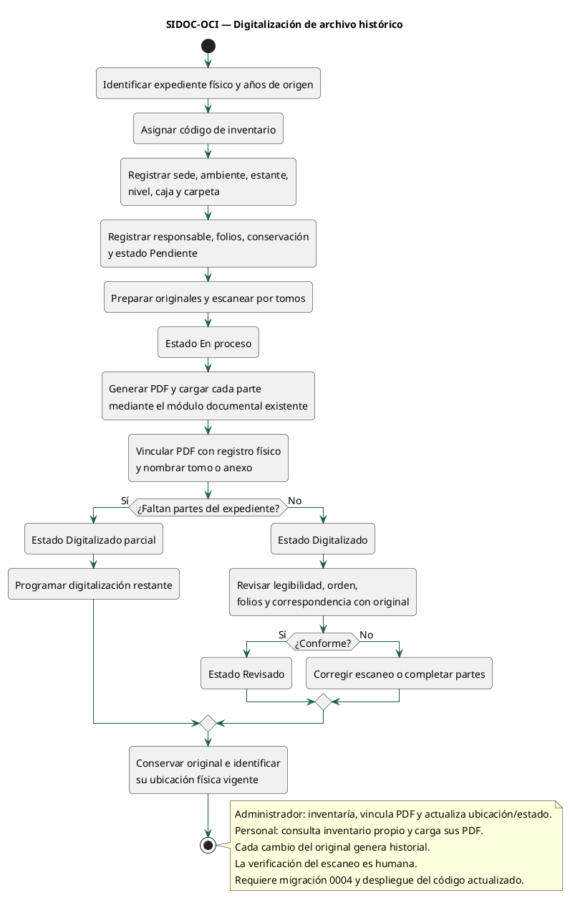
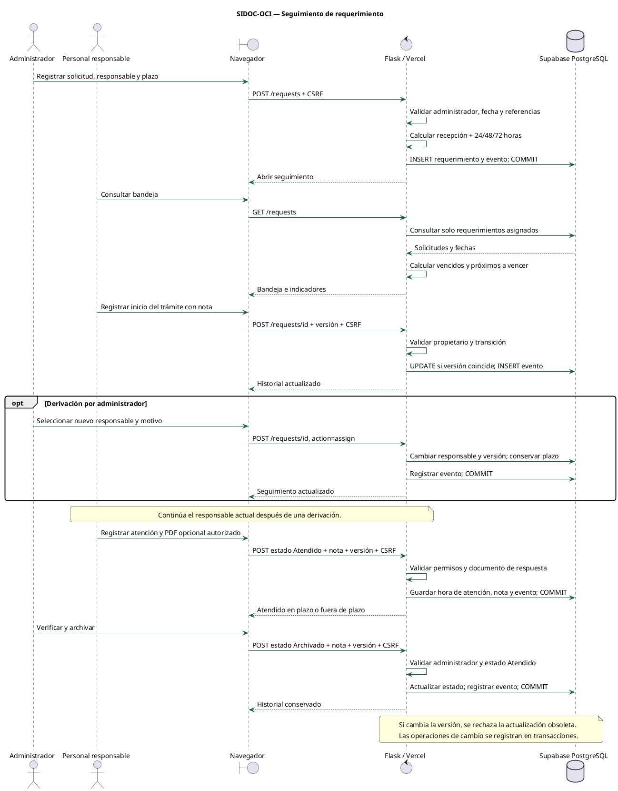
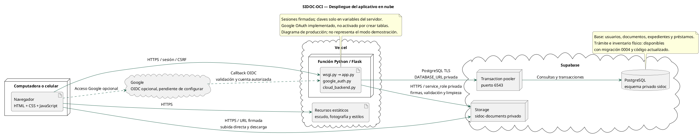

# UML de SIDOC-OCI

Fecha: 1 de noviembre de 2026. Documentación del código inspeccionado y del esquema SQL del proyecto; no constituye certificación de todas las operaciones en producción.

Los diagramas usan notación UML en PlantUML. Las clases son un modelo conceptual del dominio. Las tablas de inventario se instalaron según los resultados compartidos por el usuario. El código actualizado incorpora su interfaz, requerimientos e historial; la activación en producción requiere migración 0004 y despliegue. No se representan recomendaciones ni situaciones adversas como entidades ya implementadas, pues todavía no cuentan con tablas propias en el código.

## Archivos

- Abra `INFORME-UML.html` con un navegador para revisar o imprimir el informe (Ctrl+P → Guardar como PDF).
- PNG: imágenes listas para insertar en Word o diapositivas.
- SVG: imágenes vectoriales que pueden ampliarse sin perder nitidez.
- PUML: fuentes editables con PlantUML. Para regenerar: `java -jar plantuml.jar -charset UTF-8 -tsvg docs/uml/*.puml` (requiere Java y Graphviz).
- El paquete no incluye contraseñas, claves, datos personales ni los archivos de producción.

## Casos de uso

Define los actores y sus operaciones. El administrador hereda las funciones del personal y dispone de gestión global. El personal consulta sus documentos y expedientes asignados; no administra cuentas ni modifica documentos existentes.

Trazabilidad: app.py: protected, scope, document, expedients, users, loans y configuration; workflow.py: trámite e inventario.

[Fuente editable](01-casos-de-uso.puml) · [SVG](01-casos-de-uso.svg)

## Actividad de gestión documental

Describe el recorrido de acceso, carga, validación y consulta de PDF. La clasificación por estados es una acción administrativa, no un circuito automático de aprobación.

Trazabilidad: app.py: login, upload_start, upload_complete, edit_document y download.

[Fuente editable](02-actividad-documental.puml) · [SVG](02-actividad-documental.svg)

## Secuencia de inicio de sesión

Muestra la interacción con PostgreSQL, la verificación del hash y la creación de sesión. Google utiliza otro flujo, implementado pero pendiente de credenciales externas.

Trazabilidad: app.py: load_user y login; google_auth.py para el flujo alternativo.

[Fuente editable](03-secuencia-login.puml) · [SVG](03-secuencia-login.svg)

## Secuencia de carga de PDF

El navegador sube directamente a Storage con una URL firmada. El servidor verifica el archivo antes de registrar el documento; las credenciales de Storage no se entregan al navegador.

Trazabilidad: app.py: upload_start y upload_complete; cloud_backend.py: PrivateStorage.

[Fuente editable](04-secuencia-carga-pdf.puml) · [SVG](04-secuencia-carga-pdf.svg)

## Clases del dominio

Modelo conceptual de entidades persistidas mediante SQL, no de clases ORM Python. Incluye multiplicidades y la relación de varios PDF con un original físico. El bloque amarillo corresponde al inventario físico; incluye requerimientos e historiales incorporados por la actualización 0004.

Trazabilidad: supabase/migrations/0001_sidoc.sql, 0002_google_oauth.sql y 0003_archivo_historico.sql.

[Fuente editable](05-clases-dominio.puml) · [SVG](05-clases-dominio.svg)

## Actividad de digitalización histórica

Distingue inventariar un original sin PDF, digitalizar por partes y verificar el resultado. El código actualizado incorpora los formularios de inventario, vinculación de PDF y cambios de ubicación; requiere instalar 0004 y desplegarlo.

Trazabilidad: supabase/migrations/0003_archivo_historico.sql y docs/ARCHIVO-HISTORICO.md.

[Fuente editable](06-actividad-digitalizacion-propuesta.puml) · [SVG](06-actividad-digitalizacion-propuesta.svg)

## Secuencia de seguimiento de requerimientos

Describe registro, asignación, derivación sin reiniciar plazo, atención y archivo. Las versiones impiden sobrescribir cambios concurrentes.

Trazabilidad: workflow.py y supabase/migrations/0004_tramite_oci.sql.

[Fuente editable](08-secuencia-requerimiento.puml) · [SVG](08-secuencia-requerimiento.svg)

## Despliegue en nube

Presenta navegador, función Flask en Vercel, PostgreSQL mediante pooler y Storage privado. Google se representa como integración opcional pendiente de activar.

Trazabilidad: wsgi.py, app.py, cloud_backend.py, google_auth.py y docs/VERCEL-SUPABASE.md.

[Fuente editable](07-despliegue.puml) · [SVG](07-despliegue.svg)

